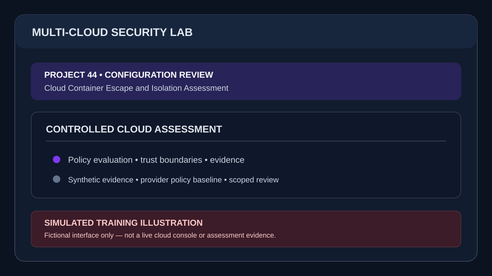

# Project 44: Cloud Container Escape and Isolation Assessment

**Level:** Advanced  
**Cloud platforms:** AWS / Azure / GCP  
**Assessment type:** Authorized cloud security review

> **Safety notice:** Use dedicated lab accounts, subscriptions, and projects that you own or are explicitly authorized to assess. Prefer read-only collection and provider-native policy simulators. Do not extract credentials, access third-party tenants, modify production controls, or create billable resources without approval. All screenshots and sample findings are simulated training material, not live assessment evidence.

## Objective
Assess container isolation, privileged settings, host mounts, capabilities, and runtime protections. Build a defensible assessment with documented scope, evidence, risk context, remediation, and independent validation.

## Scope and rules of engagement
- Identify exact cloud organization/account, tenant/subscription, project, regions, resource groups, and workload names before assessment.
- Use a dedicated least-privilege assessment identity with MFA and short-lived credentials.
- Define read-only versus approved change actions, time windows, rate limits, exclusions, contacts, stop conditions, and cleanup responsibility.
- Use synthetic identities, resources, and data. Never test an unrelated tenant or public cloud resource without written authorization.

## Prerequisites
- AWS CLI v2, Azure CLI, Google Cloud CLI, and provider console access as applicable.
- A disposable sandbox and documented resource inventory; optional Terraform plan or sanitized configuration exports.
- Python 3 for parsing sanitized JSON/CSV; jq for local JSON review.
- Current provider security documentation and an evidence register.
- Do not store credentials, access tokens, private keys, or customer exports in this repository.

## Assessment workflow
1. **Confirm identity and scope.** Verify the active principal and account context using provider-native identity commands. Stop if the account, tenant, or project is unexpected.
2. **Inventory the control plane.** Enumerate only approved resources and relevant configuration. Record collection time, region, tool version, and permissions/coverage limitations.
3. **Map trust boundaries.** Identify identities, role assignments, workload identities, network boundaries, secrets, data stores, control-plane APIs, and external integrations relevant to this project.
4. **Review configuration.** Compare observed settings with current provider guidance and an approved baseline. Use read-only queries and policy simulators; do not perform live privilege escalation or credential access.
5. **Validate safely.** Reproduce concerns with sanitized policy documents, synthetic resources, test principals, or offline configuration analysis. Avoid destructive changes and production-impacting tests.
6. **Prioritize risk.** Consider effective permissions, exposure, resource sensitivity, exploit prerequisites, blast radius, business criticality, and compensating controls. Explain uncertainty and avoid unsupported compromise claims.
7. **Recommend treatment.** Provide least-privilege policy changes, segmentation, encryption, logging, rotation, or workload hardening as relevant. Changes require owner approval and a rollback plan.
8. **Retest and report.** Repeat the original read-only checks, confirm expected access boundaries, verify service health, and document residual risk.

## Tools and example commands
Use placeholders and execute only after selecting the approved lab context.

AWS identity and account confirmation:
~~~bash
aws sts get-caller-identity
aws configure list
~~~

Azure subscription context:
~~~bash
az account show --output table
az account list --output table
~~~

GCP active project and identity context:
~~~bash
gcloud config list
gcloud auth list
gcloud projects list
~~~

For structured local review:
~~~bash
jq 'keys' sanitized-export.json
python3 -m json.tool sanitized-export.json
~~~
Provider-specific read commands and policy simulators should be selected from current official documentation. Never paste secret-bearing output into a terminal transcript or Git commit.

## Expected results
A scope-accurate inventory, configuration baseline, trust-boundary or permission analysis, validated observations, prioritized finding register, and remediation/retest plan. Sample IDs, roles, policy snippets, and results in this portfolio are fictional.

## Risk analysis
Assess confidentiality, integrity, availability, privilege boundaries, cross-account/tenant exposure, data sensitivity, persistence potential, and blast radius. Distinguish an exploitable path from a theoretical permission combination. Note scanner coverage, inherited policy behavior, stale inventory, region gaps, and assumptions.

## Remediation guidance
Apply least privilege, narrowly scoped trust conditions, short-lived identities, MFA, workload identity instead of long-lived keys, private network paths, encryption, managed secret storage, immutable audit logging, policy-as-code, and tested backups where applicable. Use provider-supported change workflows and approvals; do not remove controls blindly.

## Validation and closure
- Repeat the same read-only collection after remediation.
- Confirm intended principals retain required access and unauthorized test principals are denied.
- Validate policy scope, network reachability, logging, and service health as applicable.
- Confirm no secrets or sensitive identifiers appear in evidence.
- Record before/after configuration references, timestamps, tool versions, reviewer, and limitations.
- Classify outcomes as **fixed**, **mitigated**, **accepted**, or **not reproducible** with rationale.

## Evidence and reporting
Retain authorization, scope register, sanitized inventory, relevant policy/configuration excerpts, test cases, finding rationale, change approval, retest evidence, and residual risk. Report executive summary, provider/account coverage, methodology, limitations, prioritized findings, owners, due dates, and recommendations. Redact account IDs, tenant IDs, email addresses, resource identifiers, tokens, private keys, and customer data before publication.

## Framework and reference mapping
Map relevant controls to [CIS Controls](https://www.cisecurity.org/controls), [CIS Benchmarks](https://www.cisecurity.org/cis-benchmarks), [NIST CSF 2.0](https://www.nist.gov/cyberframework), [NIST SP 800-53](https://csrc.nist.gov/pubs/sp/800/53/r5/upd1/final), and provider-specific security foundations. Cloud control mappings are guidance, not certification claims.

## Simulated training illustrations
The following are **fictional training illustrations**, not genuine cloud console screenshots, live findings, or proof of testing.

## Completion checklist
- [ ] Written authorization and exact cloud scope recorded
- [ ] Active identity and account context verified
- [ ] Relevant resources and configuration inventoried
- [ ] Trust boundaries and risks reviewed
- [ ] Findings validated using safe lab evidence
- [ ] Remediation and approval path documented
- [ ] Retest, limitations, and residual risk recorded
- [ ] Sensitive data removed from published artifacts

---
**Portfolio note:** This is an educational assessment template. Confirm current provider CLI syntax, service behavior, pricing, and security guidance before use.
