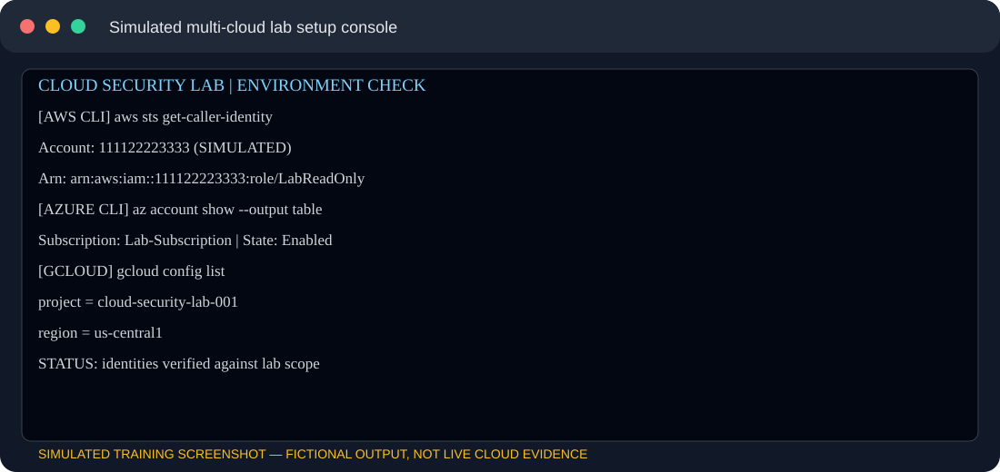
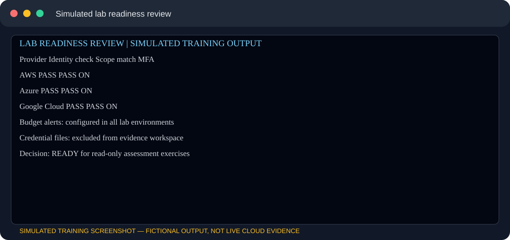

# 01. Cloud Environment Setup and Security Lab

**Level:** Beginner  
**Cloud platforms:** AWS, Microsoft Azure, Google Cloud  
**Assessment type:** Authorized, read-only security review

> **Safety and evidence notice:** This is a controlled training exercise. Run commands only against cloud accounts, tenants, and projects you own or are explicitly authorized to assess. The screenshots in this walkthrough are simulated examples with fictional names, IDs, and results; they are not evidence from a live environment. Do not publish credentials, tokens, private keys, or unredacted customer data.

## Objective

Build a controlled, low-cost multi-cloud assessment workspace and verify that the operator is authenticated to the intended lab accounts before performing any review.

## Prerequisites and lab

A dedicated AWS account or sandbox, an Azure subscription with a test tenant, and a GCP project. Use non-production accounts, enable MFA, and set budget alerts before creating resources. Install AWS CLI v2, Azure CLI, Google Cloud CLI, Git, and Python 3.

## Tools

AWS CLI, Azure CLI (`az`), Google Cloud CLI (`gcloud`), browser-based cloud consoles, and a text editor.

## Walkthrough

### Step 1 — Create isolated lab scopes

Create or select one dedicated lab account/subscription/project per provider. Record the account or tenant identifiers, project ID, region, owner, and expiration date in a local scope register. Do not place access keys, tokens, or passwords in the register or repository.

### Step 2 — Set cost and access guardrails

Enable billing alerts or budgets in each provider. Use a dedicated least-privilege assessment identity with MFA. Avoid owner/global administrator roles for routine inventory work. Do not deploy billable resources unless the lab requires them.

### Step 3 — Install and verify the AWS CLI

Install AWS CLI v2 from the official AWS instructions, then authenticate using IAM Identity Center or another approved short-lived credential flow. Run `aws --version` and `aws sts get-caller-identity`. Confirm the returned account ID matches the lab register.

### Step 4 — Authenticate to Azure

Install Azure CLI, run `az login`, then `az account list --output table`. Select the intended sandbox with `az account set --subscription <SUBSCRIPTION_ID>` and verify using `az account show --output table`.

### Step 5 — Authenticate to Google Cloud

Install Google Cloud CLI, run `gcloud auth login`, then `gcloud projects list`. Select the intended lab project with `gcloud config set project <PROJECT_ID>` and verify with `gcloud config list`.

### Step 6 — Create a safe evidence workspace

Create folders for scope, command output, screenshots, findings, and reports. Keep raw output local and redact account IDs, email addresses, resource names, and other identifiers before publishing examples. Never commit credential files.

### Step 7 — Validate the boundaries

For each provider, capture the identity and scope verification output. Confirm that the identities are read-only or otherwise appropriately constrained. If an account or project does not match the scope register, stop and correct the configuration before continuing.

## Simulated tool walkthrough screenshots

The following images illustrate the expected style of tool interaction and example review output. All displayed data is fictional.

## Expected observations

The identity commands should return the expected account, tenant/subscription, or active project context. A successful login alone does not prove that the selected environment is the intended lab.

## Remediation guidance

Use separate lab identities, MFA, short-lived credentials, least privilege, billing alerts, and explicit scope records. Remove unused lab resources and credentials after the exercise.

## Evidence and reporting

Capture CLI version, authenticated identity with sensitive fields redacted, selected subscription/project, scope register version, and date/time. Store secrets outside the repository.

A concise report for this project should include:

1. Assessment scope, authorization, date, and assessor identity.
2. Tools and versions, commands executed, and coverage limitations.
3. Executive summary and prioritized findings.
4. Evidence references with sensitive information redacted.
5. Business/security impact and reproducible validation steps.
6. Remediation recommendations and retest status.

## Cleanup

No cloud resources are created or modified by the documented commands. Remove temporary local exports when no longer needed and securely handle any evidence containing account or identity information.

## Further reading

- [AWS Security documentation](https://docs.aws.amazon.com/security/)
- [Microsoft cloud security documentation](https://learn.microsoft.com/azure/security/)
- [Google Cloud security documentation](https://cloud.google.com/security)
