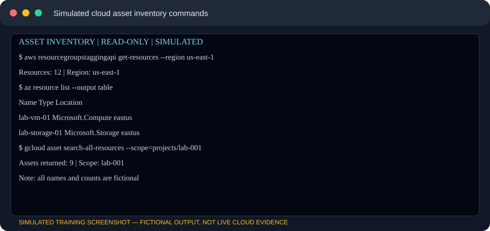
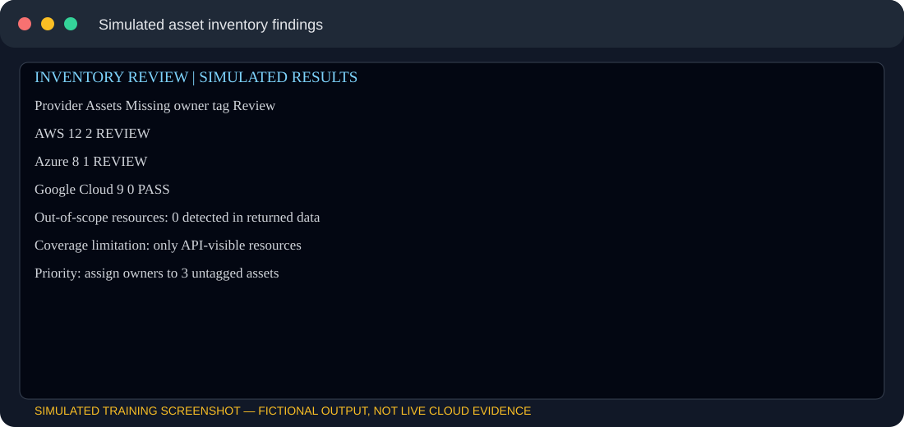
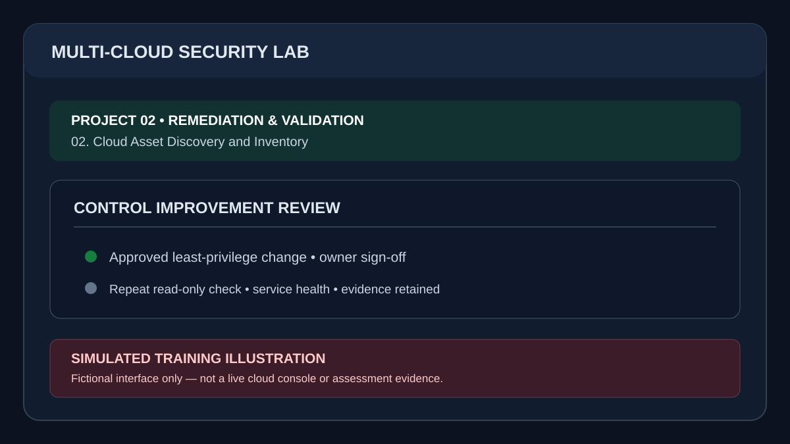

# 02. Cloud Asset Discovery and Inventory

**Level:** Beginner  
**Cloud platforms:** AWS, Microsoft Azure, Google Cloud  
**Assessment type:** Authorized, read-only security review

> **Safety and evidence notice:** This is a controlled training exercise. Run commands only against cloud accounts, tenants, and projects you own or are explicitly authorized to assess. The screenshots in this walkthrough are simulated examples with fictional names, IDs, and results; they are not evidence from a live environment. Do not publish credentials, tokens, private keys, or unredacted customer data.

## Objective

Build a read-only inventory of cloud resources and identify assets that are untagged, unexpected, or outside the documented lab scope.

## Prerequisites and lab

Complete Project 01. Use the same dedicated lab accounts and read-only identities. The identity needs permission to list resources; do not grant write access for this exercise.

## Tools

AWS CLI, Azure CLI, Google Cloud CLI, CSV or spreadsheet software.

## Walkthrough

### Step 1 — Confirm the active scope

Run `aws sts get-caller-identity`, `az account show --output table`, and `gcloud config list`. Verify the account, subscription, and project against the approved scope register.

### Step 2 — Inventory AWS resources

Run `aws resourcegroupstaggingapi get-resources --region <REGION> --output json`. This lists resources visible to the tagging API in the selected region. Repeat only for regions explicitly included in scope.

### Step 3 — Inventory Azure resources

Run `az resource list --subscription <SUBSCRIPTION_ID> --output json`. Save the output locally and note each resource's type, location, resource group, and tags.

### Step 4 — Inventory Google Cloud resources

Run `gcloud asset search-all-resources --scope=projects/<PROJECT_ID> --format=json`. This searches assets visible within the selected project. If the required Cloud Asset API or permissions are unavailable, document the limitation rather than broadening access.

### Step 5 — Normalize the inventory

Create a single table with provider, resource ID, resource type, region/location, resource group/project, tags, owner, and environment. Preserve original identifiers in private evidence; use sanitized identifiers in public examples.

### Step 6 — Compare against the scope register

Mark each resource as expected, unrecognized, missing an owner tag, missing an environment tag, or outside the approved region list. Do not delete, modify, or probe any resource.

### Step 7 — Validate and summarize

Manually spot-check a sample of listed resources in the provider console. Record API permission gaps, regions not assessed, and any inventory service limitations so the report does not imply complete coverage.

## Simulated tool walkthrough screenshots

The following images illustrate the expected style of tool interaction and example review output. All displayed data is fictional.

## Expected observations

The inventory should show resources returned by the permissions and APIs available to the assessment identity. Empty results can mean no resources, insufficient permissions, a wrong scope, or a service/API limitation; validate before concluding.

## Remediation guidance

Apply consistent resource tags, maintain an asset owner register, remove abandoned resources through an approved change process, and alert on resource creation outside approved regions.

## Evidence and reporting

Save timestamped JSON outputs privately, a sanitized inventory table, the scope register, and screenshots showing the read-only commands and summary. Redact identifiers before publication.

A concise report for this project should include:

1. Assessment scope, authorization, date, and assessor identity.
2. Tools and versions, commands executed, and coverage limitations.
3. Executive summary and prioritized findings.
4. Evidence references with sensitive information redacted.
5. Business/security impact and reproducible validation steps.
6. Remediation recommendations and retest status.

## Cleanup

No cloud resources are created or modified by the documented commands. Remove temporary local exports when no longer needed and securely handle any evidence containing account or identity information.

## Further reading

- [AWS Security documentation](https://docs.aws.amazon.com/security/)
- [Microsoft cloud security documentation](https://learn.microsoft.com/azure/security/)
- [Google Cloud security documentation](https://cloud.google.com/security)

