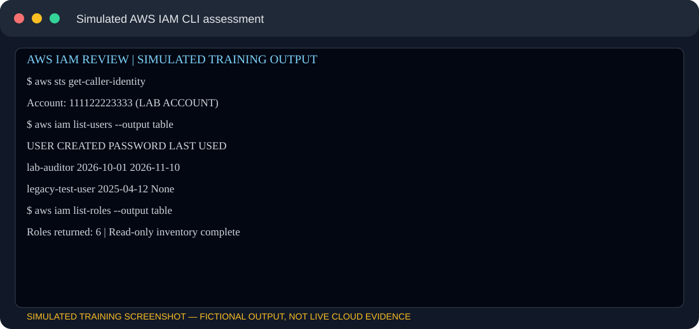
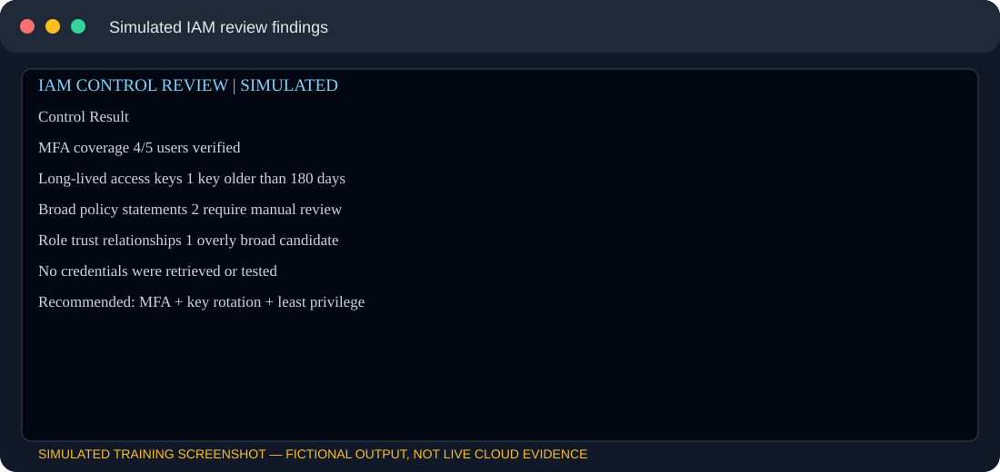

# 03. AWS IAM User and Role Security Assessment

**Level:** Beginner  
**Cloud platforms:** AWS  
**Assessment type:** Authorized, read-only security review

> **Safety and evidence notice:** This is a controlled training exercise. Run commands only against cloud accounts, tenants, and projects you own or are explicitly authorized to assess. The screenshots in this walkthrough are simulated examples with fictional names, IDs, and results; they are not evidence from a live environment. Do not publish credentials, tokens, private keys, or unredacted customer data.

## Objective

Perform a read-only review of IAM users, roles, attached policies, MFA status, and credential-age indicators in an authorized AWS lab account.

## Prerequisites and lab

An AWS lab account and an assessment identity with read-only IAM permissions. Use a test account only. Do not create users, change policies, assume unfamiliar roles, or attempt privilege escalation.

## Tools

AWS CLI v2, AWS IAM console, spreadsheet or report template.

## Walkthrough

### Step 1 — Verify the account

Run `aws sts get-caller-identity`. Confirm the account ID is the lab account before issuing IAM inventory commands.

### Step 2 — List IAM users

Run `aws iam list-users --output table`. Record user names, creation dates, and password-last-used values where returned. Treat missing values carefully; they do not necessarily prove an account is unused.

### Step 3 — Review MFA device associations

Run `aws iam list-virtual-mfa-devices --assignment-status Assigned --output table` and review each user in the IAM console. Note users with console access but no MFA association; validate the actual sign-in configuration before reporting.

### Step 4 — Review IAM roles

Run `aws iam list-roles --query 'Roles[].{RoleName:RoleName,Path:Path,Created:CreateDate}' --output table`. Identify roles with broad trust relationships or unclear ownership for further manual review.

### Step 5 — Review attached policies

For selected in-scope users and roles, run `aws iam list-attached-user-policies --user-name <USER>` or `aws iam list-attached-role-policies --role-name <ROLE>`. Inspect policy documents with `aws iam get-policy` and `aws iam get-policy-version` where authorized.

### Step 6 — Check access key age and status

Run `aws iam list-access-keys --user-name <USER> --output table` for approved test users. Record key status and creation date. Do not retrieve secret access keys or test credentials.

### Step 7 — Evaluate least privilege

Compare permissions to job function and lab requirements. Flag wildcard actions/resources, unused identities, long-lived keys, missing MFA, and roles whose trust policy is broader than necessary. Validate each observation against the full policy and applicable conditions.

### Step 8 — Write findings

Assign severity based on practical exposure and business impact. Include the exact identity/policy context, evidence, risk, and a least-privilege remediation recommendation.

## Simulated tool walkthrough screenshots

The following images illustrate the expected style of tool interaction and example review output. All displayed data is fictional.

## Expected observations

The review should produce an inventory of IAM identities, roles, attached policies, and key metadata visible to the assessor. IAM policy risk cannot be determined reliably from policy names alone; inspect the policy document and trust relationship.

## Remediation guidance

Require MFA, remove unused identities and keys through change control, replace long-lived access keys with short-lived role credentials, narrow wildcard permissions, and restrict trust policies to named principals and required conditions.

## Evidence and reporting

Capture redacted command output, policy JSON with account-specific identifiers sanitized, MFA review notes, and the finding register. Never publish access keys, session tokens, or sensitive account details.

A concise report for this project should include:

1. Assessment scope, authorization, date, and assessor identity.
2. Tools and versions, commands executed, and coverage limitations.
3. Executive summary and prioritized findings.
4. Evidence references with sensitive information redacted.
5. Business/security impact and reproducible validation steps.
6. Remediation recommendations and retest status.

## Cleanup

No cloud resources are created or modified by the documented commands. Remove temporary local exports when no longer needed and securely handle any evidence containing account or identity information.

## Further reading

- [AWS Security documentation](https://docs.aws.amazon.com/security/)
- [Microsoft cloud security documentation](https://learn.microsoft.com/azure/security/)
- [Google Cloud security documentation](https://cloud.google.com/security)

