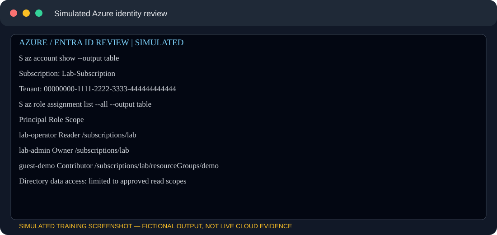
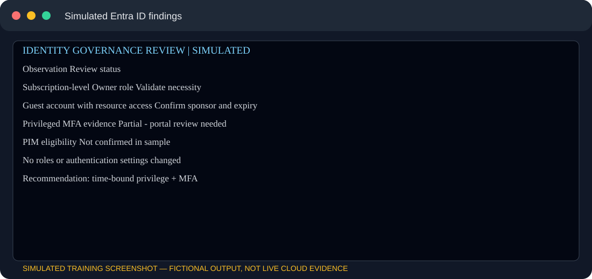

# 04. Azure Entra ID Identity Security Assessment

**Level:** Beginner  
**Cloud platforms:** Microsoft Azure  
**Assessment type:** Authorized, read-only security review

> **Safety and evidence notice:** This is a controlled training exercise. Run commands only against cloud accounts, tenants, and projects you own or are explicitly authorized to assess. The screenshots in this walkthrough are simulated examples with fictional names, IDs, and results; they are not evidence from a live environment. Do not publish credentials, tokens, private keys, or unredacted customer data.

## Objective

Review identity and role-assignment hygiene in an authorized Azure lab tenant, focusing on user inventory, privileged role assignments, and MFA-related visibility.

## Prerequisites and lab

Complete Project 01 and select the intended Azure tenant/subscription. Use an authorized read-only identity. Some Entra ID directory queries require Microsoft Graph permissions or directory roles; document missing access rather than requesting broad privileges.

## Tools

Azure CLI, Microsoft Entra admin center, Microsoft Graph PowerShell (optional).

## Walkthrough

### Step 1 — Verify tenant and subscription

Run `az account show --output json` and record the tenant ID and subscription context in private evidence. Confirm it matches the scope register.

### Step 2 — Inventory Azure resources and subscription role assignments

Run `az role assignment list --all --include-inherited --output json`. Review principal, role definition, scope, and whether assignments are inherited.

### Step 3 — List visible directory users

Run `az ad user list --query '[].{displayName:displayName,userPrincipalName:userPrincipalName,accountEnabled:accountEnabled}' --output table` if the assessment identity has the required directory permissions. Do not export unnecessary personal data.

### Step 4 — Review directory roles

Use the Microsoft Entra admin center to inspect assigned directory roles and eligible assignments. Distinguish Microsoft Entra directory roles from Azure RBAC roles; they govern different control planes.

### Step 5 — Review MFA and authentication methods

Use the Entra authentication methods and sign-in reporting views available to the authorized assessor. Record coverage and policy configuration. Do not infer MFA status solely from the presence of a user object or a subscription role assignment.

### Step 6 — Identify risky assignment patterns

Look for permanent privileged assignments, broad subscription-level roles, stale guest accounts, disabled users retaining assignments, and unclear ownership. Confirm the exact scope and effective permissions before assigning severity.

### Step 7 — Validate findings

Spot-check each candidate in the portal. Record data freshness, licensing/reporting limitations, and any Graph permission gaps. Avoid changing assignments during the assessment.

### Step 8 — Recommend remediation

Recommend least-privilege role scopes, time-bound privileged access through PIM where available, removal of stale access through change control, and strong authentication policies.

## Simulated tool walkthrough screenshots

The following images illustrate the expected style of tool interaction and example review output. All displayed data is fictional.

## Expected observations

Azure RBAC controls access to Azure resources, while Entra ID directory roles control directory functions. A user may have one, both, or neither. MFA reporting availability depends on tenant configuration, licensing, and permissions.

## Remediation guidance

Use Privileged Identity Management for eligible roles where available, minimize standing privilege, scope Azure RBAC assignments narrowly, review guest access, and enforce phishing-resistant MFA for privileged identities.

## Evidence and reporting

Save sanitized role-assignment exports, screenshots of the relevant Entra role and authentication settings, tenant scope notes, and a finding register. Minimize or redact user principal names and tenant identifiers.

A concise report for this project should include:

1. Assessment scope, authorization, date, and assessor identity.
2. Tools and versions, commands executed, and coverage limitations.
3. Executive summary and prioritized findings.
4. Evidence references with sensitive information redacted.
5. Business/security impact and reproducible validation steps.
6. Remediation recommendations and retest status.

## Cleanup

No cloud resources are created or modified by the documented commands. Remove temporary local exports when no longer needed and securely handle any evidence containing account or identity information.

## Further reading

- [AWS Security documentation](https://docs.aws.amazon.com/security/)
- [Microsoft cloud security documentation](https://learn.microsoft.com/azure/security/)
- [Google Cloud security documentation](https://cloud.google.com/security)
