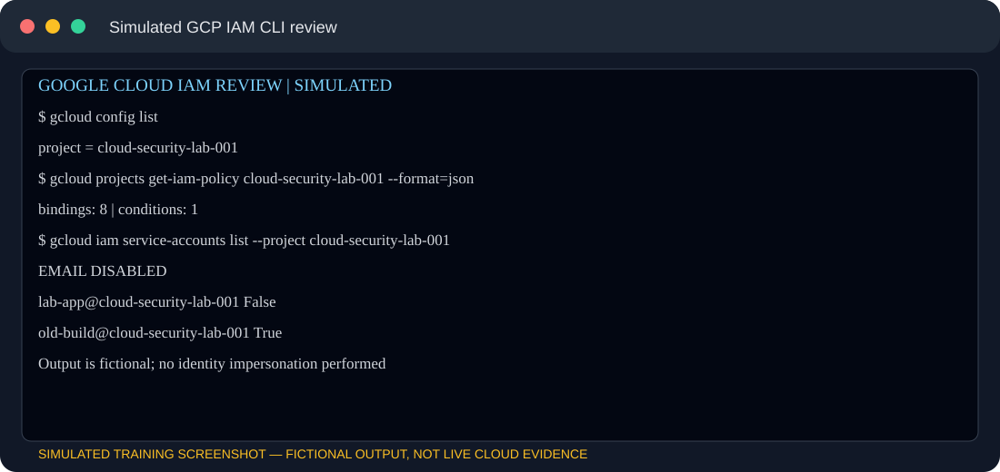
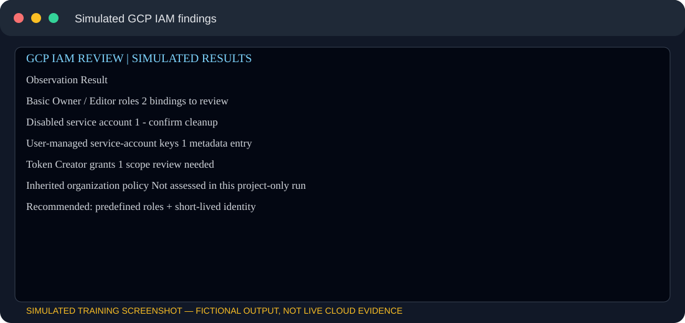

# 05. GCP IAM Roles and Permissions Assessment

**Level:** Beginner  
**Cloud platforms:** Google Cloud  
**Assessment type:** Authorized, read-only security review

> **Safety and evidence notice:** This is a controlled training exercise. Run commands only against cloud accounts, tenants, and projects you own or are explicitly authorized to assess. The screenshots in this walkthrough are simulated examples with fictional names, IDs, and results; they are not evidence from a live environment. Do not publish credentials, tokens, private keys, or unredacted customer data.

## Objective

Review project-level IAM bindings and service accounts in an authorized Google Cloud lab project, identifying broad roles, stale principals, and service-account key risks.

## Prerequisites and lab

A dedicated GCP lab project and an approved read-only identity. Ensure the identity can view IAM policy and service-account metadata. Do not impersonate service accounts, create keys, or modify bindings.

## Tools

Google Cloud CLI (`gcloud`), Google Cloud console, optional Cloud Asset Inventory.

## Walkthrough

### Step 1 — Confirm the active project

Run `gcloud config list` and `gcloud projects describe <PROJECT_ID>`. Confirm the project ID and project number against the scope register.

### Step 2 — Export the project IAM policy

Run `gcloud projects get-iam-policy <PROJECT_ID> --format=json`. Store the output privately and redact member email addresses and project identifiers before sharing.

### Step 3 — Review role bindings

Group bindings by role and principal. Flag basic roles such as Owner and Editor, broad principals, external members, and service accounts with unclear ownership. Check conditions and inherited organization/folder policies where in scope.

### Step 4 — Inventory service accounts

Run `gcloud iam service-accounts list --project <PROJECT_ID> --format='table(email,displayName,disabled)'`. Record enabled status and ownership without attempting authentication as those accounts.

### Step 5 — Review service-account key metadata

For each approved service account, run `gcloud iam service-accounts keys list --iam-account <SERVICE_ACCOUNT_EMAIL> --managed-by=user --project <PROJECT_ID>`. Record key metadata only; never download or expose private key material.

### Step 6 — Check for risky service-account permissions

Review bindings that allow service-account impersonation or token creation, such as `roles/iam.serviceAccountTokenCreator`, and determine whether the grant is required and narrowly scoped. Do not exercise impersonation.

### Step 7 — Validate and assess

Compare principals to the lab owner register, inspect role definitions, and check whether access is inherited. Distinguish direct project bindings from organization/folder-level policy.

### Step 8 — Document and recommend

Record evidence, scope, risk, affected principal, and remediation. Recommend predefined roles, custom least-privilege roles where appropriate, short-lived credentials, and removal of unused user-managed keys.

## Simulated tool walkthrough screenshots

The following images illustrate the expected style of tool interaction and example review output. All displayed data is fictional.

## Expected observations

Project IAM output may not include inherited organization or folder grants. The service-account key listing is metadata only and does not reveal private key contents. Missing permissions should be reported as a coverage limitation.

## Remediation guidance

Replace basic roles with narrower predefined roles, limit service-account impersonation grants, disable unused accounts, remove obsolete user-managed keys through change control, and prefer workload identity federation or short-lived credentials.

## Evidence and reporting

Retain sanitized IAM policy JSON, service-account metadata, command timestamps, and screenshots. Never commit private keys, tokens, or unredacted principal lists.

A concise report for this project should include:

1. Assessment scope, authorization, date, and assessor identity.
2. Tools and versions, commands executed, and coverage limitations.
3. Executive summary and prioritized findings.
4. Evidence references with sensitive information redacted.
5. Business/security impact and reproducible validation steps.
6. Remediation recommendations and retest status.

## Cleanup

No cloud resources are created or modified by the documented commands. Remove temporary local exports when no longer needed and securely handle any evidence containing account or identity information.

## Further reading

- [AWS Security documentation](https://docs.aws.amazon.com/security/)
- [Microsoft cloud security documentation](https://learn.microsoft.com/azure/security/)
- [Google Cloud security documentation](https://cloud.google.com/security)
