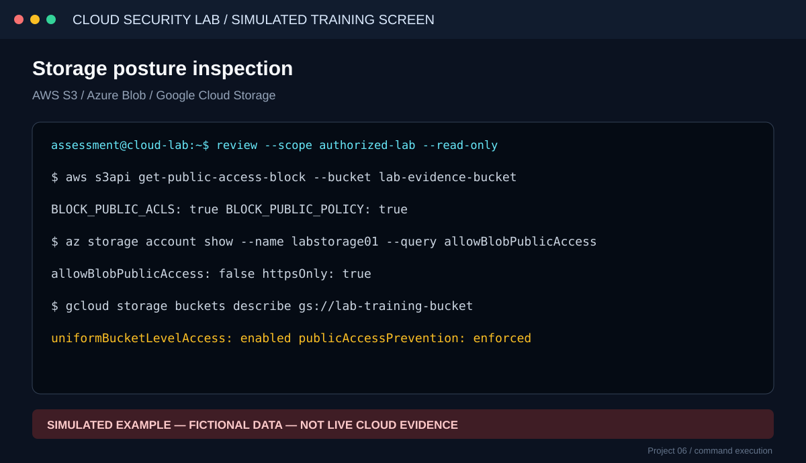
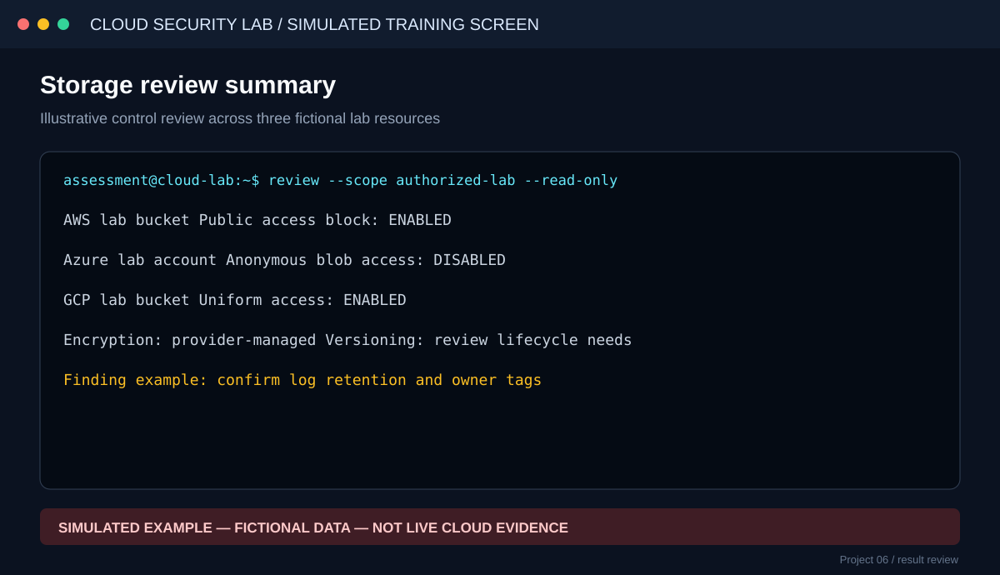

# 06. Cloud Storage Security Assessment

**Level:** Beginner  
**Platforms:** AWS S3, Azure Blob Storage, Google Cloud Storage  
**Assessment type:** Authorized, read-only configuration review

> **Safety and evidence:** Use only a lab account or explicitly authorized tenant/project. All screenshots in this guide are simulated, use fictional data, and are not evidence from a live cloud environment. Do not attempt to access objects you do not own, enumerate unrelated tenants, or download customer data.

## Objective

Assess storage-container exposure, access controls, encryption settings, logging, and lifecycle configuration across the three major cloud platforms.

## Lab and prerequisites

- Complete Projects 01 and 02 and verify the active account, subscription, and project.
- Use a read-only identity with permission to list storage resources and inspect their configuration.
- Create one empty test container/bucket in your own lab if needed. Add only synthetic files such as `public-test.txt` containing non-sensitive text.
- Do not enable public access for the purpose of this exercise.

## Tools

AWS CLI, Azure CLI, Google Cloud CLI, AWS S3 console, Azure Storage browser, Google Cloud console.

## Walkthrough

### Step 1 — Confirm scope and identity

```bash
aws sts get-caller-identity
az account show --output table
gcloud config list
```

Confirm each provider context matches the scope register. If a provider is not part of this engagement, skip it and record it as out of scope.

### Step 2 — Inventory AWS S3 buckets

```bash
aws s3api list-buckets --query 'Buckets[].Name' --output table
```

For each approved bucket, inspect its public-access block, encryption, versioning, and logging configuration:

```bash
aws s3api get-public-access-block --bucket <LAB_BUCKET>
aws s3api get-bucket-encryption --bucket <LAB_BUCKET>
aws s3api get-bucket-versioning --bucket <LAB_BUCKET>
aws s3api get-bucket-logging --bucket <LAB_BUCKET>
```

A missing configuration response is not automatically proof of public exposure. Check bucket policy, ACL behavior, account-level S3 Block Public Access, and applicable organization controls. Do not issue anonymous object requests against buckets outside your scope.

### Step 3 — Inventory Azure Storage accounts

```bash
az storage account list --query '[].{name:name,resourceGroup:resourceGroup,location:location,httpsOnly:enableHttpsTrafficOnly,publicBlob:allowBlobPublicAccess}' --output table
```

For an approved storage account, inspect network rules and encryption properties:

```bash
az storage account show --name <STORAGE_ACCOUNT> --resource-group <RESOURCE_GROUP> --query '{httpsOnly:enableHttpsTrafficOnly,publicBlob:allowBlobPublicAccess,networkRuleSet:networkRuleSet,encryption:encryption}' --output json
```

Review container-level anonymous access in the portal or with an authorized data-plane identity. Avoid printing storage keys or connection strings.

### Step 4 — Inventory Google Cloud Storage buckets

```bash
gcloud storage buckets list --project <PROJECT_ID>
gcloud storage buckets describe gs://<LAB_BUCKET> --format=json
```

Review IAM bindings and uniform bucket-level access:

```bash
gcloud storage buckets get-iam-policy gs://<LAB_BUCKET> --format=json
```

Check public access prevention, uniform access, retention, encryption, and logging settings. Inspect only metadata and policy; do not list or retrieve unrelated object contents.

### Step 5 — Build a comparable control matrix

For each container record: provider, resource name (sanitized in public reports), public-access prevention, identity-based access, encryption at rest, TLS enforcement, versioning/soft delete, logging, retention, network restrictions, owner, and environment tag.

### Step 6 — Validate candidate findings

For each suspected issue, verify the effective policy at both resource and account/organization level. Distinguish:
- Public access explicitly granted.
- Broad authenticated access within an organization.
- Missing visibility caused by insufficient permissions.
- A recommended control that is not applicable to the service or workload.

Do not test access by retrieving real objects. Use only the synthetic object in your own lab when a functional check is required.

### Step 7 — Rate risk and report

Prioritize confirmed anonymous access to sensitive data as critical/high depending on data classification and exposure. Missing versioning or logging is usually a resilience/detection gap, not proof of disclosure. Include evidence, scope, impact, and a least-privilege fix.

## Simulated walkthrough screenshots

All output and resource names below are fictional training examples.





## Expected observations

You should be able to compare public-access controls, encryption, versioning/retention, logging, and network restrictions. Provider defaults and inherited policies differ; document the exact control checked rather than assuming equivalent behavior.

## Remediation

Block public access unless a documented business case requires it; prefer identity-based access, enforce TLS, enable suitable encryption and audit logs, use retention/versioning appropriate to recovery objectives, and periodically review grants.

## Evidence and report

Keep timestamped configuration exports privately. Redact account IDs, bucket names, principal emails, and object paths before publishing. Record API permission gaps and services not assessed.

## Cleanup

No configuration changes are required. If you created a lab bucket, remove only your synthetic test object and bucket after verifying it contains no needed evidence.
