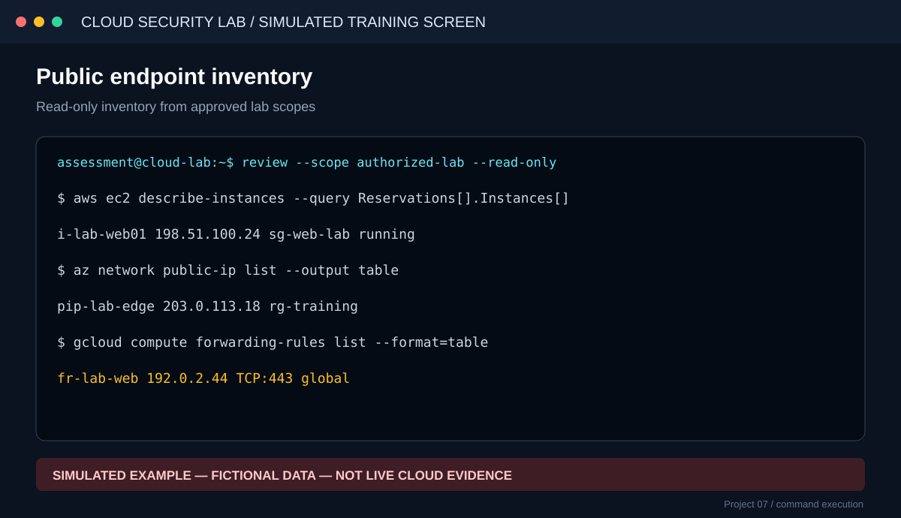
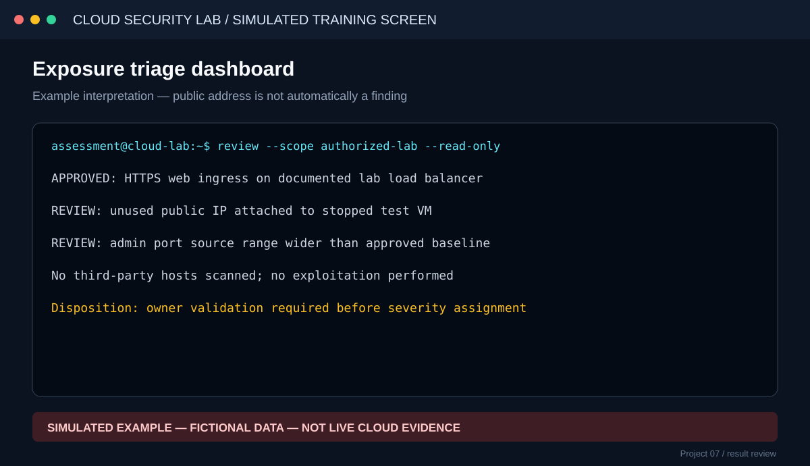

# 07. Public Cloud Resource Exposure Assessment

**Level:** Beginner  
**Platforms:** AWS, Microsoft Azure, Google Cloud  
**Assessment type:** Authorized, read-only exposure review

> **Safety and evidence:** This exercise is limited to resources in accounts, subscriptions, and projects you own or are explicitly authorized to assess. Screenshots are simulated fictional training examples, not live evidence. Do not scan public IP ranges or probe third-party services.

## Objective

Identify cloud resources that are intentionally or unintentionally reachable from the public internet, then validate whether exposure is necessary and appropriately restricted.

## Prerequisites and tools

Complete Projects 01–02. Use read-only cloud inventory permissions. Tools: AWS CLI, Azure CLI, Google Cloud CLI, provider consoles, and a spreadsheet for the asset register.

## Walkthrough

### Step 1 — Reconfirm authorized scope

Verify AWS account, Azure tenant/subscription, and GCP project. Obtain the written list of in-scope regions and resource groups. Do not infer scope from resources discovered.

### Step 2 — Identify AWS public-facing resources

```bash
aws ec2 describe-instances --query 'Reservations[].Instances[].{Id:InstanceId,State:State.Name,PublicIp:PublicIpAddress,Subnet:SubnetId,Groups:SecurityGroups[].GroupId}' --output table
aws elbv2 describe-load-balancers --query 'LoadBalancers[].{Name:LoadBalancerName,Scheme:Scheme,State:State.Code,DNS:DNSName}' --output table
aws ec2 describe-addresses --output table
```

A public IP or internet-facing load balancer is not automatically a vulnerability. Correlate it with approved architecture, listener ports, security groups, authentication, and service purpose.

### Step 3 — Identify Azure public endpoints

```bash
az network public-ip list --query '[].{name:name,ip:ipAddress,allocation:publicIPAllocationMethod,resourceGroup:resourceGroup}' --output table
az network lb list --query '[].{name:name,resourceGroup:resourceGroup,frontend:frontendIPConfigurations[].publicIPAddress.id}' --output json
az network application-gateway list --query '[].{name:name,resourceGroup:resourceGroup,provisioningState:provisioningState}' --output table
```

Review associated NSGs, listeners, backend pools, WAF policy, and whether the endpoint is approved. Do not send test traffic to a public endpoint unless that specific validation is authorized.

### Step 4 — Identify GCP external endpoints

```bash
gcloud compute instances list --format='table(name,zone,status,networkInterfaces[].accessConfigs[].natIP)'
gcloud compute forwarding-rules list --format='table(name,region,IPAddress,IPProtocol,ports,target)'
gcloud compute addresses list --filter='addressType=EXTERNAL' --format=table
```

Review firewall rules and load balancer configuration to understand what the external address exposes.

### Step 5 — Map exposure to business purpose

Create a register with resource, owner, environment, public endpoint, exposed service/port, approved purpose, authentication control, WAF or filtering control, logging, and review date. Mark unknown owners as an inventory issue.

### Step 6 — Validate only within approved boundaries

Use provider configuration and architecture records first. If an active check is explicitly authorized, test only the named endpoint and approved ports using a conservative rate and time window. Stop if the endpoint differs from the approved target or causes instability. Do not perform exploitation or credential testing.

### Step 7 — Document confirmed exposure

Separate necessary public services from unexpected exposure. A public address alone is an observation; an unnecessary management interface exposed to all sources is a stronger finding. Include exact resource scope and supporting configuration evidence.

## Simulated walkthrough screenshots

All displayed resources, addresses, and findings are fictional.





## Expected observations

You should produce a list of public IPs, load balancers, and internet-facing services, each linked to its security controls and documented owner. Expect some intentionally public web endpoints.

## Remediation

Remove unused public IPs, restrict administrative access to approved VPN/bastion or trusted source ranges, use WAF protections where appropriate, enforce strong authentication, and alert on new internet-facing resources.

## Evidence and report

Save sanitized inventory output, approved-scope references, diagrams, and configuration screenshots. Do not publish real IPs, hostnames, tenant IDs, or customer names.

## Cleanup

This is a read-only review. No cloud resources are created or changed.
