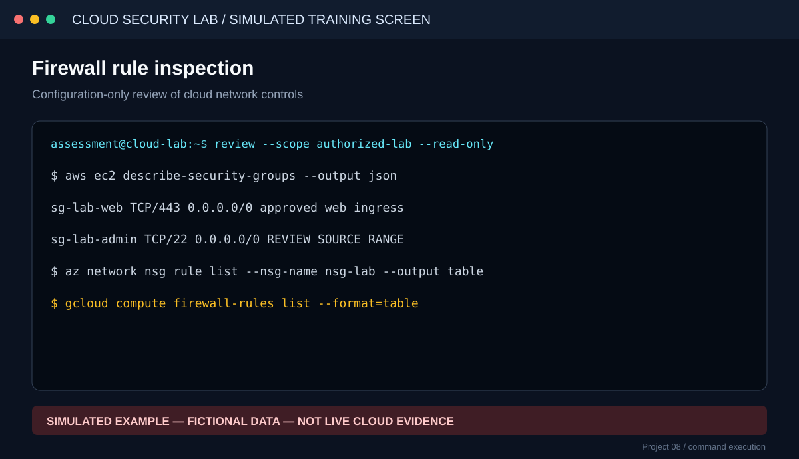
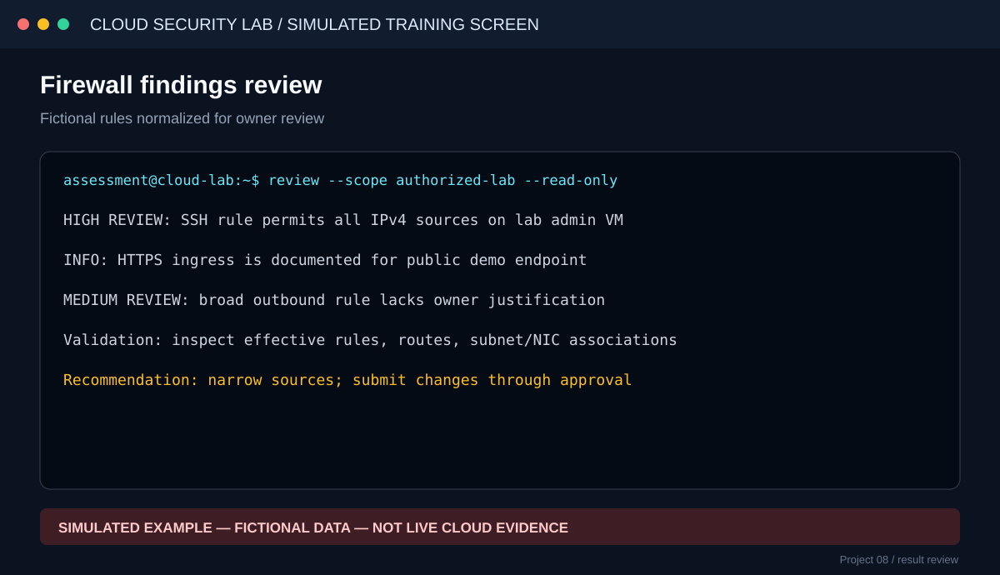

# 08. Cloud Security Group and Firewall Assessment

**Level:** Beginner  
**Platforms:** AWS, Microsoft Azure, Google Cloud  
**Assessment type:** Authorized, read-only network-control review

> **Safety and evidence:** Assess only explicitly authorized cloud environments. The screenshots are simulated and fictional. This walkthrough reviews firewall configuration; it does not authorize scanning unrelated IP addresses, exploiting exposed services, or changing production rules.

## Objective

Review cloud firewall rules for overly broad ingress/egress, unnecessary management ports, undocumented rules, and inconsistent network policy.

## Prerequisites and tools

Complete Projects 01–02. Use read-only permissions to inspect network security configuration. Tools: AWS CLI, Azure CLI, Google Cloud CLI, provider consoles, and a rule-review worksheet.

## Walkthrough

### Step 1 — Confirm environment and boundaries

Verify account/subscription/project and approved regions. Record the intended network ranges and permitted management source ranges. Do not assume that a CIDR is safe simply because it belongs to a corporate network.

### Step 2 — Review AWS security groups

```bash
aws ec2 describe-security-groups --query 'SecurityGroups[].{GroupId:GroupId,Name:GroupName,VpcId:VpcId,Ingress:IpPermissions,Egress:IpPermissionsEgress}' --output json
```

For each in-scope group, inspect inbound protocol, port range, source IPv4/IPv6 ranges, referenced security groups, and outbound destinations. Flag broad sources such as `0.0.0.0/0` or `::/0` on administrative ports for validation. Do not treat every public web port as a defect.

### Step 3 — Review Azure NSGs

```bash
az network nsg list --query '[].{name:name,resourceGroup:resourceGroup,id:id}' --output table
az network nsg rule list --resource-group <RESOURCE_GROUP> --nsg-name <NSG_NAME> --include-default --output table
```

Review priority, direction, access, protocol, source/destination prefixes, and ports. Check both subnet- and NIC-associated NSGs because effective behavior depends on their combined rules.

### Step 4 — Review GCP VPC firewall rules

```bash
gcloud compute firewall-rules list --format='table(name,network,direction,priority,sourceRanges,allowed,denied,targetTags,disabled)'
```

Review source ranges, target tags/service accounts, allowed protocols and ports, direction, priority, and disabled status. Consider hierarchical firewall policies where they are in scope.

### Step 5 — Normalize and identify risky patterns

Build a table with provider, rule ID/name, direction, source/destination, protocol/ports, target, priority, business owner, and justification. Flag:
- Administrative ports open to broad internet ranges.
- Any/any rules without documented need.
- Unrestricted egress where policy requires egress control.
- Duplicate, stale, or shadowed rules.
- Rules with unclear owner or purpose.

### Step 6 — Validate effective access

Use provider effective-rule views and architecture diagrams to confirm the actual path. Check route tables, network ACLs, subnet associations, load balancers, and inherited policies. Do not infer reachability from one rule in isolation.

### Step 7 — Recommend changes without applying them

Prepare a proposed change set for the owner to approve. Narrow source ranges, restrict ports, remove obsolete rules, and test changes in a non-production environment before deployment.

## Simulated walkthrough screenshots

All rule names, ranges, and outputs are fictional examples.





## Expected observations

The review should identify rule patterns requiring owner validation. A permissive rule may be mitigated by another control or may support an approved public service; document the full network path and business context.

## Remediation

Apply least-privilege ingress and egress, use managed prefix lists or approved source ranges where appropriate, remove stale rules through change control, and continuously monitor firewall policy changes.

## Evidence and reporting

Retain sanitized rule exports, effective-rule screenshots, network diagrams, and a change recommendation list. Include limitations such as unavailable organization-level policies.

## Cleanup

No changes are made in this exercise. Submit proposed changes to the cloud/network owner for separate approval.
