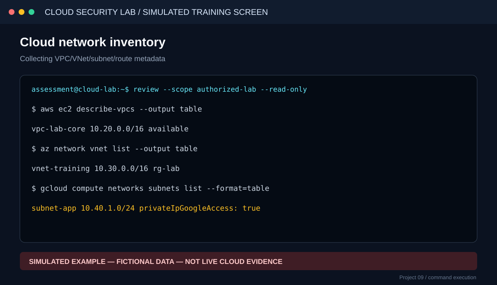
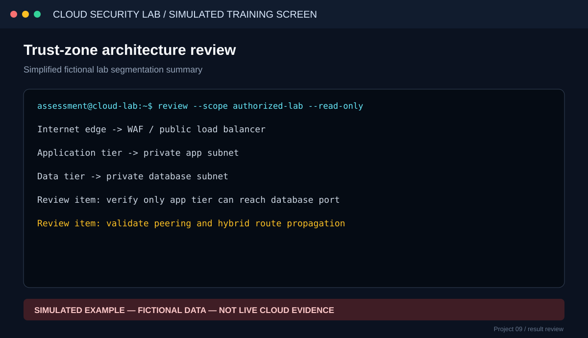

# 09. Cloud Network Architecture Review

**Level:** Beginner  
**Platforms:** AWS, Microsoft Azure, Google Cloud  
**Assessment type:** Authorized architecture and configuration review

> **Safety and evidence:** Use only diagrams and cloud environments within your authorization. Screenshots are simulated examples with fictional names and addresses. Do not enumerate or test networks outside the documented scope.

## Objective

Understand the cloud network layout, trust boundaries, routing, segmentation, ingress/egress paths, and management access. Identify design risks before active testing.

## Prerequisites and tools

Complete Projects 01–02. Obtain approved architecture diagrams and read-only network inventory access. Tools: AWS CLI, Azure CLI, Google Cloud CLI, provider network visualizers, and a diagramming tool.

## Walkthrough

### Step 1 — Establish architecture scope

Record accounts/projects, regions, VPCs/VNets, approved CIDRs, connected on-premises networks, VPN/Direct Connect/ExpressRoute/Interconnect links, and excluded environments. Confirm diagram owner and date.

### Step 2 — Map AWS network components

```bash
aws ec2 describe-vpcs --query 'Vpcs[].{VpcId:VpcId,Cidr:CidrBlock,State:State}' --output table
aws ec2 describe-subnets --query 'Subnets[].{SubnetId:SubnetId,VpcId:VpcId,Cidr:CidrBlock,AZ:AvailabilityZone,PublicIp:MapPublicIpOnLaunch}' --output table
aws ec2 describe-route-tables --output json
aws ec2 describe-nat-gateways --output table
```

Map internet gateways, NAT gateways, route tables, subnets, security groups, and VPC endpoints. Confirm whether a subnet is public based on its route path, not its name alone.

### Step 3 — Map Azure virtual networks

```bash
az network vnet list --query '[].{name:name,resourceGroup:resourceGroup,addressSpace:addressSpace.addressPrefixes}' --output table
az network vnet subnet list --resource-group <RESOURCE_GROUP> --vnet-name <VNET_NAME> --output table
az network route-table list --output table
az network vnet peering list --resource-group <RESOURCE_GROUP> --vnet-name <VNET_NAME> --output table
```

Review subnet associations, user-defined routes, peering flags, private endpoints, gateways, and NSG associations.

### Step 4 — Map GCP VPC components

```bash
gcloud compute networks list --format='table(name,autoCreateSubnetworks,routingConfig.routingMode)'
gcloud compute networks subnets list --format='table(name,region,network,ipCidrRange,privateIpGoogleAccess)'
gcloud compute routes list --format='table(name,network,destRange,nextHopGateway,nextHopInstance,nextHopIp,priority)'
gcloud compute vpn-tunnels list --format=table
```

Review custom/automatic subnet mode, route priorities, Cloud NAT, private Google access, peering, and VPN connectivity.

### Step 5 — Draw trust zones and data flows

Create a diagram showing internet edge, public ingress, DMZ/application tier, data tier, management plane, shared services, and hybrid connectivity. Label traffic direction and the security control enforcing each boundary.

### Step 6 — Review segmentation and management paths

Check whether databases and internal services are reachable only from required application tiers. Identify shared subnets, broad peering, transitive routing assumptions, unrestricted management paths, and overlapping CIDRs. Validate each concern with effective routes and firewall policy.

### Step 7 — Assess resilience and exposure

Review availability zones/zones, redundant gateways, DNS dependencies, egress paths, centralized inspection, and logging. Record single points of failure and any unmonitored network paths.

### Step 8 — Produce architecture findings

For each finding include affected zone, data flow, observed configuration, threat scenario, business impact, and recommended design. Do not label a path exploitable without validating all controls in the path.

## Simulated walkthrough screenshots

The topology and command output are fictional training examples.





## Expected observations

You should have an up-to-date logical diagram and a list of trust boundaries, external connections, routing paths, and segmentation questions. Differences between provider network models should be called out.

## Remediation

Separate workloads by sensitivity and function, restrict peering and route propagation, use private endpoints where appropriate, centralize egress inspection, protect management paths, and monitor network configuration drift.

## Evidence and reporting

Store diagrams with version/date, sanitized route and subnet exports, scope notes, and finding references. Avoid publishing real internal CIDRs or connection details unless explicitly approved.

## Cleanup

No cloud resources or network settings are modified.
