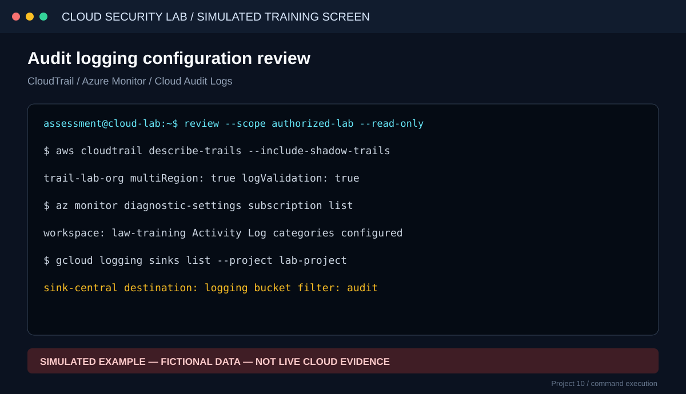
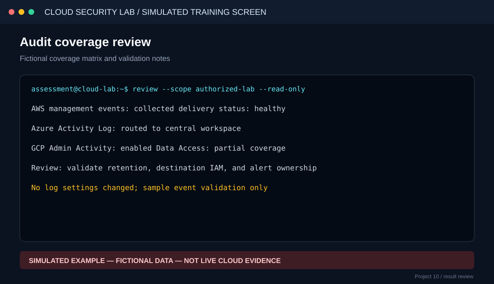

# 10. Cloud Logging and Audit Configuration Assessment

**Level:** Beginner  
**Platforms:** AWS, Microsoft Azure, Google Cloud  
**Assessment type:** Authorized, read-only audit-readiness review

> **Safety and evidence:** Use only accounts and tenants you are authorized to assess. Screenshots are simulated fictional examples. Do not disable logs, alter retention, generate disruptive events, or access unrelated audit records.

## Objective

Determine whether important control-plane and security events are collected, retained, protected, and available to responders across AWS, Azure, and GCP.

## Prerequisites and tools

Complete Project 01. Use read-only audit/configuration permissions. Tools: AWS CLI, Azure CLI, Google Cloud CLI, CloudTrail, Azure Activity Log/Diagnostic Settings, Cloud Audit Logs, and the relevant provider consoles.

## Walkthrough

### Step 1 — Define audit requirements

Agree on critical event types, required regions/projects/subscriptions, retention period, approved destinations, alert ownership, and time synchronization. Distinguish control-plane audit logs from application, data-access, network, and identity logs.

### Step 2 — Inspect AWS CloudTrail

```bash
aws cloudtrail describe-trails --include-shadow-trails --output table
aws cloudtrail get-trail-status --name <TRAIL_ARN>
aws cloudtrail get-event-selectors --trail-name <TRAIL_ARN>
```

Review multi-region coverage, organization trail status where applicable, management/data event selectors, log-file validation, destination bucket controls, encryption, and delivery status. Do not change selectors during this review.

### Step 3 — Inspect Azure Activity Log and diagnostic settings

```bash
az monitor diagnostic-settings subscription list --output json
az monitor activity-log list --offset 7d --max-events 20 --output table
```

Review subscription-level diagnostic settings and whether required categories are routed to an approved Log Analytics workspace, storage account, or event hub. Resource-level diagnostic settings may need separate inspection.

### Step 4 — Inspect GCP audit logging configuration

```bash
gcloud projects get-iam-policy <PROJECT_ID> --format=json
gcloud logging sinks list --project <PROJECT_ID> --format='table(name,destination,filter)'
gcloud logging buckets list --project <PROJECT_ID> --location=<LOCATION>
```

Review Admin Activity, System Event, Policy Denied, and Data Access audit log coverage. Data Access logs may require explicit enablement for some services and can have cost implications. Inspect sinks, destinations, exclusions, retention, and access to log buckets.

### Step 5 — Compare coverage

Build a matrix of provider, scope, log category, enabled status, destination, retention, encryption/access controls, integrity protections, alerting, and owner. Mark unknown or inaccessible settings as coverage gaps, not as confirmed disabled controls.

### Step 6 — Validate detection workflow safely

Use existing approved sample events or a harmless read-only action in your lab. Confirm the event appears in the expected log destination and that the timestamp, actor, resource, and outcome are present. Do not create failed-login storms or modify security settings to generate evidence.

### Step 7 — Review protection and response readiness

Check who can delete or alter logs, whether log storage is separated from workload administration, whether retention meets policy, and whether high-value events trigger actionable alerts. Confirm responders know how to access the records.

### Step 8 — Document gaps and recommendations

Prioritize missing critical audit coverage, unprotected log destinations, inadequate retention, and unowned alert workflows. Estimate data volume/cost before enabling additional data events.

## Simulated walkthrough screenshots

All log names, event IDs, timestamps, and findings are fictional.





## Expected observations

The assessment should show which scopes and event categories are covered, where records are stored, how long they are retained, and who can modify them. Logging configuration alone does not prove that alerts are monitored or incidents are handled.

## Remediation

Enable required audit categories, centralize logs in protected destinations, restrict log administration, set policy-aligned retention, monitor delivery failures, and test alert ownership and response procedures.

## Evidence and reporting

Capture sanitized trail/sink/diagnostic-setting metadata, sample harmless events, retention configuration, and a coverage matrix. Redact principal names, resource IDs, and sensitive event details before publication.

## Cleanup

No settings are changed. If a harmless lab event was generated, retain or delete it according to the lab evidence policy.
