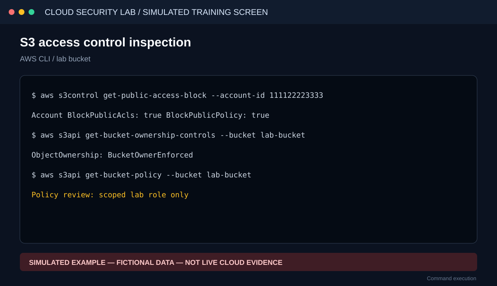
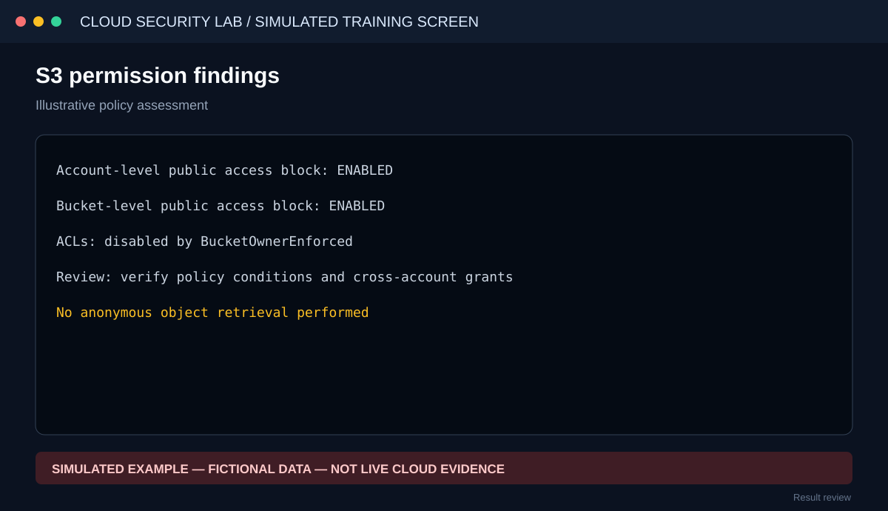

# 11. AWS S3 Bucket Permissions Testing

**Level:** Beginner | **Platform:** AWS | **Mode:** Authorized, read-only

> Run only in your own AWS lab or an explicitly authorized account. The embedded screenshots are simulated, fictional examples—not live evidence. Never retrieve real customer objects or publish bucket policies containing sensitive identifiers.

## Objective
Evaluate S3 bucket-level and account-level access controls, including public-access blocks, bucket policies, ACL posture, and effective permissions.

## Prerequisites and tools
Complete Project 03 and Project 06. Use AWS CLI v2 with read-only S3/IAM permissions. Have one empty lab bucket containing synthetic data only.

## Walkthrough

### 1. Confirm account and bucket scope
```bash
aws sts get-caller-identity
aws s3api list-buckets --query 'Buckets[].Name' --output table
```
Compare the account ID and bucket name to the written scope. Stop if they do not match.

### 2. Inspect account-level public access block
```bash
aws s3control get-public-access-block --account-id <ACCOUNT_ID>
```
Record all four settings. If the account-level configuration is absent or inaccessible, note that as a coverage limitation and inspect the bucket-level settings separately.

### 3. Inspect bucket-level public access block
```bash
aws s3api get-public-access-block --bucket <LAB_BUCKET>
```
Review BlockPublicAcls, IgnorePublicAcls, BlockPublicPolicy, and RestrictPublicBuckets. A missing block configuration is not by itself proof that a bucket is public.

### 4. Review bucket policy and ACL metadata
```bash
aws s3api get-bucket-policy --bucket <LAB_BUCKET> --query Policy --output text
aws s3api get-bucket-acl --bucket <LAB_BUCKET> --output json
```
Review principals, actions, resources, conditions, and grants. Treat wildcard principals and public groups as high-priority review items; determine whether conditions and account-level controls constrain access. Do not test anonymous access against buckets outside the lab.

### 5. Review object ownership and access model
```bash
aws s3api get-bucket-ownership-controls --bucket <LAB_BUCKET>
aws s3api get-bucket-encryption --bucket <LAB_BUCKET>
```
Document whether Bucket owner enforced is enabled and whether ACLs are disabled. Record encryption configuration without exposing key material.

### 6. Validate effective access safely
Use IAM policy simulation only where the required permissions are granted and the simulation is within scope. Compare policy statements to the expected lab role. If functional validation is required, use only a synthetic object in your own bucket and an approved test principal.

### 7. Record and remediate
For each finding record exact policy statement, effective principal, affected resource, condition context, impact, and remediation. Recommend account- and bucket-level public access blocks, least-privilege principals, Bucket owner enforced where suitable, and policy review through change control.

## Simulated tool screenshots



## Expected observations
A defensible result distinguishes public policy statements, ACL grants, account guardrails, and access denied by higher-level controls. Do not infer exposure from a single policy fragment.

## Evidence and cleanup
Save sanitized policy JSON and configuration output privately. Never commit access keys, account-specific ARNs, real object names, or customer data. No changes are made by this exercise.
