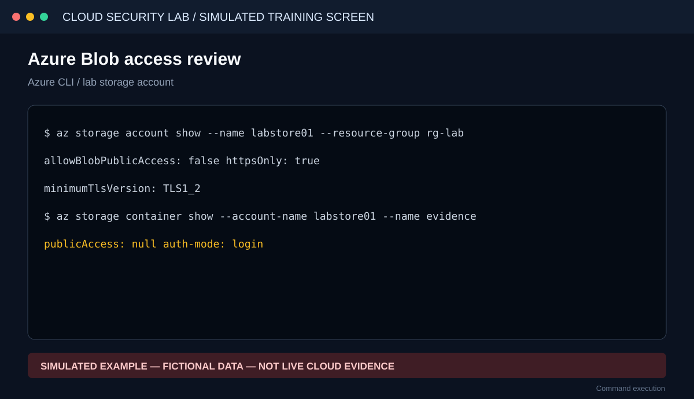
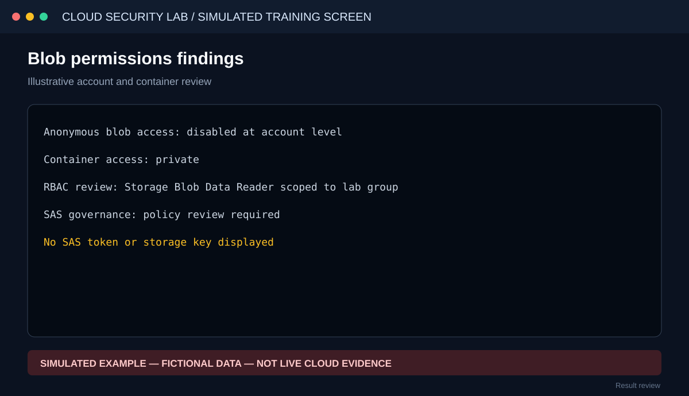

# 12. Azure Blob Storage Permissions Testing

**Level:** Beginner | **Platform:** Microsoft Azure | **Mode:** Authorized, read-only

> Use only your lab storage account or an explicitly authorized tenant. Screenshots are simulated and fictional. Do not enumerate or download objects from other tenants or customer containers.

## Objective
Assess Azure Blob anonymous access settings, container access levels, Azure RBAC data roles, shared access signature governance, and network restrictions.

## Prerequisites and tools
Complete Projects 04 and 06. Use Azure CLI and portal access with read-only management/data-plane permissions. Use a test container with synthetic content.

## Walkthrough

### 1. Confirm tenant and subscription
```bash
az account show --query '{tenant:tenantId,subscription:id,name:name}' --output json
```
Confirm the context matches the engagement scope.

### 2. Inventory storage accounts
```bash
az storage account list --query '[].{name:name,resourceGroup:resourceGroup,location:location,publicBlob:allowBlobPublicAccess,httpsOnly:enableHttpsTrafficOnly}' --output table
```
Record only approved accounts. Avoid outputting account keys or connection strings.

### 3. Review account-level anonymous access
```bash
az storage account show --name <ACCOUNT> --resource-group <RG> --query '{allowBlobPublicAccess:allowBlobPublicAccess,httpsOnly:enableHttpsTrafficOnly,minimumTlsVersion:minimumTlsVersion,networkRuleSet:networkRuleSet}' --output json
```
Confirm anonymous blob access is disabled unless a documented use case requires it. Review default network action, allowed IPs, virtual networks, and trusted-service exceptions.

### 4. Inspect container access level
Use the Azure portal Storage Browser or an authorized data-plane identity to inspect the test container's public access level. If using CLI, authenticate with Entra ID and avoid account keys:
```bash
az storage container show --account-name <ACCOUNT> --name <CONTAINER> --auth-mode login --output json
```
Check whether access is private, blob-only, or container-wide. Do not change the setting.

### 5. Review Azure RBAC data permissions
```bash
az role assignment list --scope <STORAGE_ACCOUNT_RESOURCE_ID> --include-inherited --all --output json
```
Review Storage Blob Data Reader/Contributor/Owner grants, group membership ownership, scope, and inherited roles. Management-plane Reader does not automatically mean data-plane read access.

### 6. Review SAS governance
Review organizational policy and application design for user-delegation SAS, expiry, allowed protocols, permissions, and revocation strategy. Do not create or publish a live SAS token as part of this assessment.

### 7. Validate and report
Use only a synthetic object and an approved test identity if a functional test is required. Record configuration, access model, exceptions, and evidence limitations. Recommend private containers, Entra ID authorization, narrow RBAC scope, HTTPS-only, and restrictive network rules.

## Simulated tool screenshots



## Expected observations
The result should separate account-level anonymous-access allowance, container-level access level, RBAC data-plane roles, and network controls. A setting allowing public blobs does not prove a specific container is anonymously readable.

## Evidence and cleanup
Retain sanitized settings and role assignments. Never expose SAS tokens, account keys, connection strings, tenant user lists, or customer object names. No configuration changes are made.
