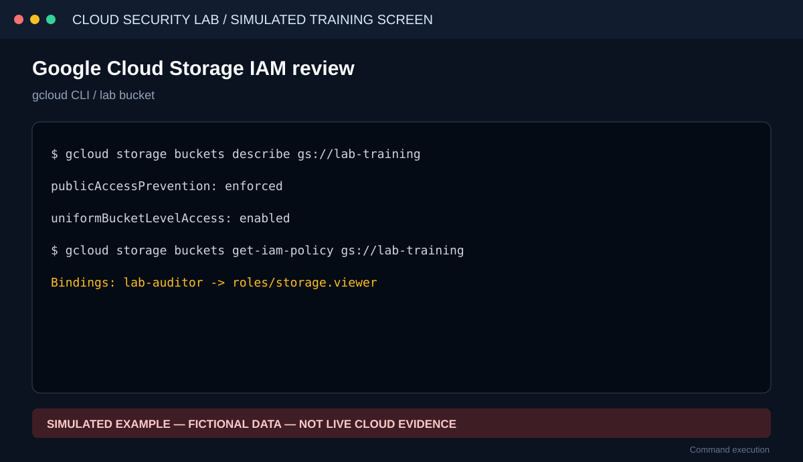
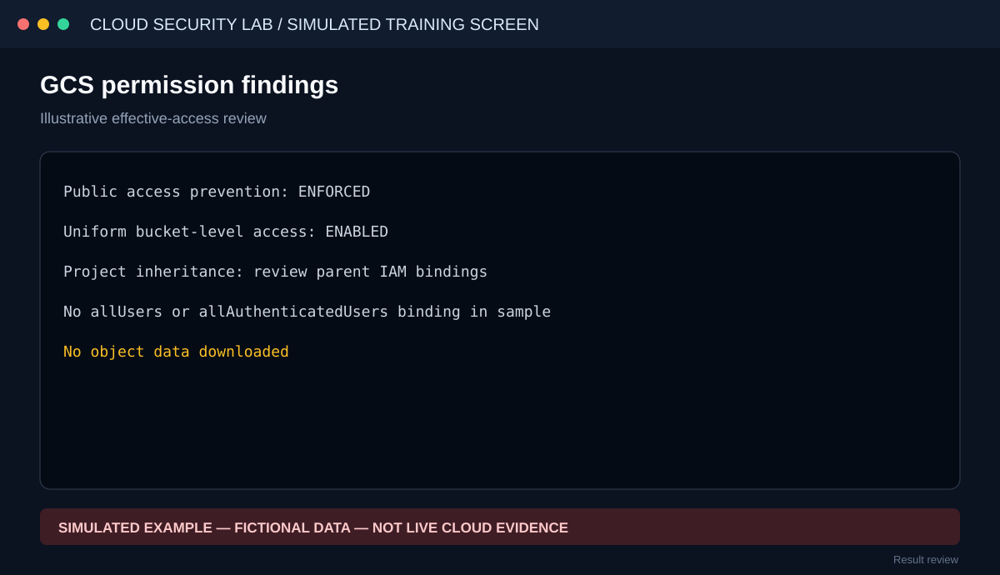

# 13. Google Cloud Storage Permissions Testing

**Level:** Beginner | **Platform:** Google Cloud | **Mode:** Authorized, read-only

> Assess only buckets in your authorized GCP project. Screenshots are simulated fictional training examples. Do not access or enumerate objects belonging to other projects or organizations.

## Objective
Review Google Cloud Storage IAM bindings, public access prevention, uniform bucket-level access, object ACL posture, and inherited permissions.

## Prerequisites and tools
Complete Projects 05 and 06. Use gcloud CLI with read-only Storage and IAM permissions. Have a dedicated lab bucket containing synthetic data.

## Walkthrough

### 1. Confirm active project
```bash
gcloud config list
gcloud projects describe <PROJECT_ID> --format='value(projectId,projectNumber)'
```
Verify the project against the approved scope register.

### 2. Inventory in-scope buckets
```bash
gcloud storage buckets list --project <PROJECT_ID>
```
Record bucket names privately and include only approved buckets in the review.

### 3. Inspect bucket configuration
```bash
gcloud storage buckets describe gs://<LAB_BUCKET> --format=json
```
Review publicAccessPrevention, uniformBucketLevelAccess, retention policy, versioning, location, encryption configuration, and logging-related settings.

### 4. Inspect bucket IAM policy
```bash
gcloud storage buckets get-iam-policy gs://<LAB_BUCKET> --format=json
```
Review members and roles. Flag allUsers and allAuthenticatedUsers for validation, as well as broad project groups and service accounts. Check conditions and inherited organization/folder/project policy before concluding that access is effective.

### 5. Review project-level grants
```bash
gcloud projects get-iam-policy <PROJECT_ID> --format=json
```
Identify principals with Storage Object Viewer, Storage Admin, or custom roles that include object access. Note that project-level grants can affect bucket access even when the bucket policy itself looks restrictive.

### 6. Check ACL and uniform access model
If uniform bucket-level access is enabled, legacy object ACLs are disabled for access decisions. If it is not enabled, review whether object ACLs introduce a separate permission path. Do not change ACLs during the assessment.

### 7. Validate only with synthetic content
If authorized functional validation is required, use a synthetic object in the lab bucket and a dedicated test principal. Never fetch real user data or probe buckets outside scope.

### 8. Document risk and remediation
Recommend public access prevention, uniform bucket-level access, least-privilege IAM roles, conditional grants where appropriate, and removal of obsolete principals through change control.

## Simulated tool screenshots



## Expected observations
A complete review considers bucket IAM, project/folder/organization inheritance, public access prevention, and legacy ACL behavior. A bucket-only policy export may not show all effective access.

## Evidence and cleanup
Store sanitized IAM policy and bucket metadata privately. Never publish object names, principal emails, project identifiers, or key material. No settings are changed.


