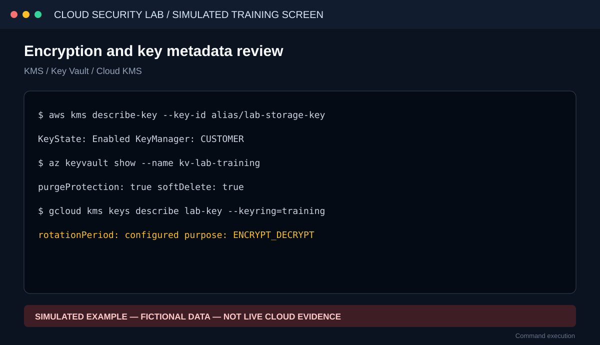
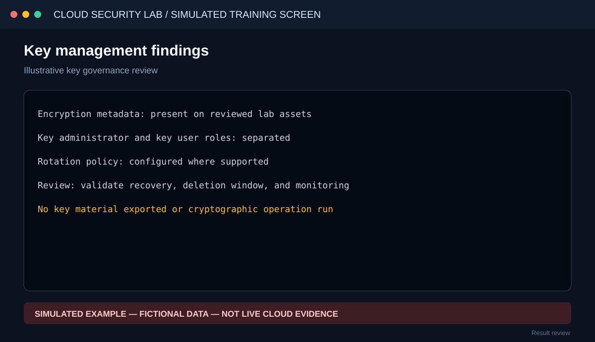
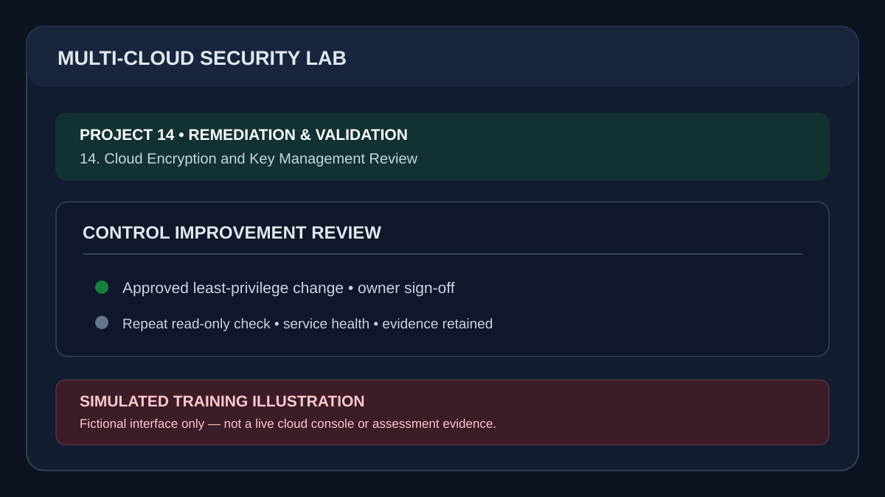

# 14. Cloud Encryption and Key Management Review

**Level:** Beginner | **Platforms:** AWS, Azure, GCP | **Mode:** Authorized, read-only

> This is a configuration review in owned or explicitly authorized cloud environments. Screenshots are simulated. Never export key material, decrypt production data, rotate keys, or change key policies during this exercise.

## Objective
Review encryption at rest, key ownership, key access policy, rotation settings, TLS enforcement, and key lifecycle controls across cloud providers.

## Prerequisites and tools
Complete Projects 01 and 06. Use read-only permissions for KMS/Key Vault/Cloud KMS metadata. Tools: AWS CLI, Azure CLI, gcloud, and provider consoles.

## Walkthrough

### 1. Define the encryption scope
List in-scope storage, databases, disks, secrets, and backups. Identify the data classification and encryption requirements for each. Distinguish provider-managed encryption from customer-managed keys.

### 2. Inspect AWS KMS keys
```bash
aws kms list-keys --output table
aws kms describe-key --key-id <KEY_ID> --output json
aws kms get-key-rotation-status --key-id <KEY_ID>
aws kms get-key-policy --key-id <KEY_ID> --policy-name default
```
Review key state, origin, key manager, rotation status where supported, policy principals/actions, grants, aliases, and deletion window. Do not call encrypt/decrypt or export key material.

### 3. Inspect Azure Key Vault
```bash
az keyvault list --query '[].{name:name,resourceGroup:resourceGroup,location:location,enableRbacAuthorization:properties.enableRbacAuthorization}' --output table
az keyvault show --name <VAULT_NAME> --query '{enablePurgeProtection:properties.enablePurgeProtection,softDelete:properties.enableSoftDelete,networkAcls:properties.networkAcls}' --output json
```
Review RBAC or access-policy model, purge protection, soft delete, firewall/private endpoint configuration, key rotation policy, and diagnostic logging. Do not retrieve secret values or key material.

### 4. Inspect Google Cloud KMS
```bash
gcloud kms keyrings list --location=<LOCATION> --project=<PROJECT_ID>
gcloud kms keys list --keyring=<KEYRING> --location=<LOCATION> --project=<PROJECT_ID>
gcloud kms keys describe <KEY_NAME> --keyring=<KEYRING> --location=<LOCATION> --project=<PROJECT_ID>
```
Review protection level, purpose, primary version, rotation schedule, state, and IAM policy. Do not export or use key material.

### 5. Verify service encryption settings
For selected lab resources, inspect storage/database/disk encryption metadata and identify the configured key reference. Confirm whether TLS is enforced for data in transit. Do not assume encryption is enabled merely because the cloud service supports it.

### 6. Evaluate key access and lifecycle
Check separation of duties, key administrators versus key users, service identities, broad principals, disabled versions, rotation intervals, backup/recovery, deletion protection, and alerting on policy changes.

### 7. Report gaps
Record asset, data classification, encryption mode, key owner, access policy, rotation, recovery controls, and logging. State any inaccessible key configuration as a limitation rather than a confirmed failure.

## Simulated tool screenshots



## Expected observations
The assessment should show which assets use provider-managed or customer-managed encryption, who can administer/use keys, and whether lifecycle controls meet policy. Rotation support and semantics vary by provider and key type.

## Remediation
Use customer-managed keys when required by risk or regulation, separate key administration from data access, restrict key use to necessary service identities, enable appropriate rotation and deletion protections, and monitor key policy changes.

## Evidence and cleanup
Save sanitized metadata and policy excerpts only. Never commit secrets, key material, access tokens, or sensitive resource identifiers. No key operations or configuration changes are performed.



