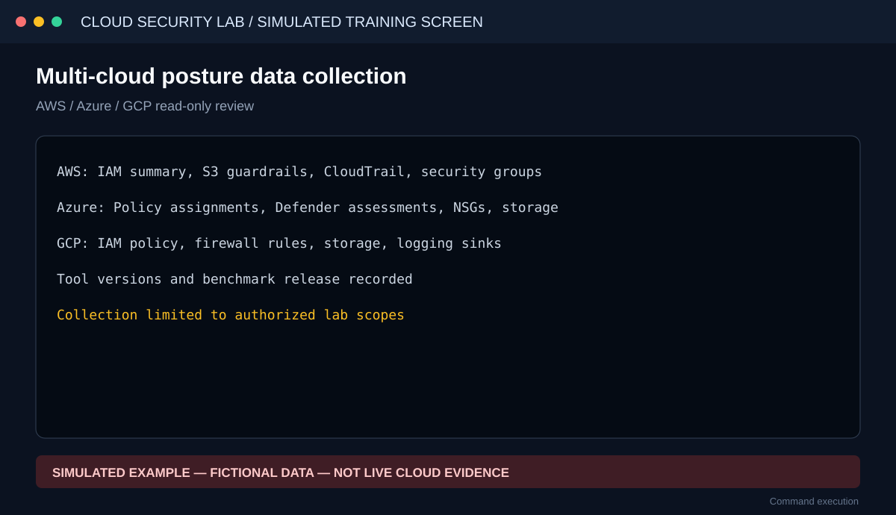

# 15. Cloud Security Posture Assessment

**Level:** Beginner | **Platforms:** AWS, Azure, GCP | **Mode:** Authorized, read-only baseline review

> This project is a scoped configuration assessment, not a guarantee of complete security. Use only owned or explicitly authorized accounts. Screenshots contain fictional simulated results, not live evidence. Do not run intrusive checks or change cloud controls.

## Objective
Combine identity, storage, network, exposure, encryption, asset inventory, and logging reviews into a prioritized cloud security posture report.

## Prerequisites and tools
Complete Projects 01–14 or document which control areas are unavailable. Tools: AWS CLI, Azure CLI, gcloud, provider security dashboards, ScoutSuite or Prowler where approved, and a finding register.

## Walkthrough

### 1. Freeze the scope
Record account/tenant/project IDs privately, regions, services, exclusions, assessment window, authorization contact, and read-only identity. Verify each active CLI context before collecting data.

### 2. Select a baseline
Choose a recognized baseline appropriate to the engagement, such as CIS Foundations Benchmark for the relevant provider or an organization-approved cloud security standard. Record benchmark version and applicable exclusions. Do not mix benchmark versions without documenting it.

### 3. Collect AWS posture data
Use approved read-only collection. Examples:
```bash
aws sts get-caller-identity
aws iam get-account-summary
aws s3control get-public-access-block --account-id <ACCOUNT_ID>
aws cloudtrail describe-trails --include-shadow-trails
aws ec2 describe-security-groups --output json
```
Optional: run Prowler against the explicitly scoped lab account using the approved read-only role. Review the tool's permissions, version, and output before execution.

### 4. Collect Azure posture data
```bash
az account show --output json
az policy assignment list --all --output table
az security assessment list --output table
az network nsg list --output table
az storage account list --output table
```
Defender for Cloud assessment visibility depends on subscription plan and permissions. Document unavailable recommendations rather than interpreting missing data as a pass.

### 5. Collect GCP posture data
```bash
gcloud config list
gcloud projects get-iam-policy <PROJECT_ID> --format=json
gcloud compute firewall-rules list --format=json
gcloud storage buckets list --project <PROJECT_ID>
gcloud logging sinks list --project <PROJECT_ID>
```
Where available, review Security Command Center findings and organization policy constraints within the approved scope.

### 6. Normalize findings
Create one register with provider, resource, control family, benchmark reference, evidence, status (pass/fail/not applicable/not assessed), severity, confidence, owner, remediation, and due date. Deduplicate findings that arise from the same root cause.

### 7. Validate false positives and coverage
Manually inspect high-risk results in provider consoles. Confirm effective permissions, inherited controls, exceptions, service applicability, and evidence freshness. Do not treat scanner output as final without validation.

### 8. Prioritize remediation
Prioritize exploitable public exposure and excessive privileged access, then data protection, logging/detection, and hygiene. Consider business impact, data sensitivity, likelihood, compensating controls, and remediation complexity.

### 9. Produce the executive report
Summarize scope, benchmark, coverage, risk distribution, top findings, limitations, and a 30/60/90-day remediation roadmap. Include retest criteria for each high-risk item.

## Simulated tool screenshots



## Expected observations
You should produce a defensible baseline view with clear coverage boundaries and prioritized findings. A posture score is a point-in-time indicator, not proof that an environment is secure.

## Remediation
Assign accountable owners, track fixes to closure, automate drift detection, improve least privilege and segmentation, centralize audit logging, and schedule periodic reassessment.

## Evidence and cleanup
Retain sanitized exports, tool versions, benchmark references, and validation notes. Keep raw account data private. This project is read-only; follow approved cleanup procedures for any local reports.


